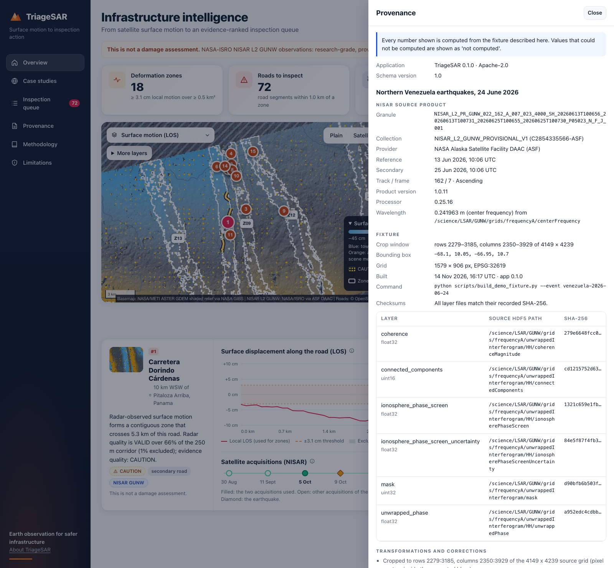

# TriageSAR

**From NISAR surface motion to an evidence-ranked infrastructure inspection queue.**

> See where the ground moved. Know where to inspect first.

NASA Space Apps Challenge 2026 · challenge **"Dancing with the SARs"** ·
https://www.spaceappschallenge.org/2026/challenges/

**Live demo: https://pasindu508.github.io/TriageSAR/**

> **This is not a damage assessment.** TriageSAR does not detect structural damage, does not predict
> casualties and does not treat satellite observations as ground truth. It ranks where radar evidence of
> ground motion meets roads, so people can decide where to look first.

## The problem

After a large earthquake, hundreds of kilometres of road may be affected and field teams cannot inspect
everything first. The NASA–ISRO NISAR radar can show where the ground moved, but interferometric products are
hard to read, and a colourful displacement map does not tell a planner which road to drive to.

## What TriageSAR does

1. Reads a real **NISAR Level-2 GUNW** interferogram (unwrapped phase, coherence, connected components, mask).
2. Converts phase to **line-of-sight range change** with the wavelength taken from the product's own metadata.
3. **Quality-gates** every pixel as VALID, CAUTION or EXCLUDED with transparent, configurable rules.
4. Extracts **contiguous deformation zones** from quality-approved pixels (screening threshold, minimum area).
5. **Intersects** the zones with OpenStreetMap roads and summarises the radar evidence along each road corridor.
6. Produces a deterministic **inspection priority score** (weighted sum of six visible factors) and tests how
   stable the ranking is when the weights change.
7. Shows, for every recommendation, the **evidence, its quality, its dates, its source granule and its limits**.

## Why it is different

Existing satellite portals help experts inspect raster products. TriageSAR does not try to replace them. Its
contribution is the decision layer that comes *after* the map: quality-aware deformation evidence, intersected
with infrastructure, turned into an inspection order that a judge can audit by hand. There is no machine
learning and no language model in the ranking.

## Screenshots

All screenshots are of real NISAR case studies, captured with `node scripts/capture_screenshots.mjs`.

| | |
|---|---|
|  |  |
| Kumamoto, Japan: 16 zones, ranked roads, evidence for rank 1 | Venezuela: local motion, three zones, no road ranked |
|  |  |
| Full evidence and "Why is this ranked #1?" | Provenance: granule, dates, checksums, build command |

The layout adapts from desktop to phone (top-bar menu, stacked dashboard, collapsible legend):
`docs/screenshots/07-phone-dashboard.png`.

## The four case studies

Each is one real NISAR L2 GUNW interferogram whose two acquisitions bracket a 2026 earthquake, analysed with
identical settings. Figures from `make analyse` (details in [BUILD_REPORT.md](BUILD_REPORT.md)).

| Case study | Pair | Valid / excluded pixels | Zones | Roads ranked | Road pixels unobserved |
|---|---|---|---:|---:|---:|
| Northern Venezuela, M 7.5, 24 Jun 2026 | 13 → 25 Jun (12 days) | 30% / 49% | 3 | 0 | 20% |
| Kumamoto, Japan, M 6.8, 28 Jul 2026 | 21 Jul → 14 Aug (24 days) | 37% / 41% | 16 | 936 (ranking UNSTABLE) | 25% |
| Azuero Peninsula, Panama, M 7.7, 9 Oct 2026 | 5 → 17 Oct (12 days, partial frame) | 11% / 84% | 18 | 72 | 63% |
| Flores Sea, Indonesia, M 7.8, 14 Aug 2026 | 12 → 24 Aug (12 days) | 40% / 47% | 0 | 0 | 3% |

The results differ because the ground and the radar did: Kumamoto's rupture was on land under a dense road
network; Venezuela's motion was smooth over the whole coastal range; the Flores epicentre was offshore; most of
the Panama frame is unobserved. TriageSAR reports each case as measured, including when it ranks nothing.

## Quick start (about five minutes)

Requirements: Python 3.12, Node.js 20 or newer, `make`.

```bash
make setup     # Python virtual environment + web dependencies
make start     # builds the web app and serves the release app on http://localhost:8000
```

The app runs offline from the prepared fixtures and needs no credentials. Four real NISAR fixtures (6.9–15 MB
each) and their OpenStreetMap extracts are in `data/fixtures/`; `make verify-data` checks their SHA-256. The
optional Satellite and Terrain basemaps are NASA GIBS tiles and need a connection; everything else is local.

## Real NASA data workflow

```bash
# 1. Find granules (no account needed) - queries the ASF Search API
python scripts/discover_nisar.py --bbox -68.5 9.5 -65.5 11.5 --start 2026-06-10 --end 2026-07-05 --product GUNW

# 2. Add credentials: copy .env.example to .env and set EARTHDATA_TOKEN (https://urs.earthdata.nasa.gov/)

# 3. Build the fixture. Reads only the study-area window of the 2.3 GB product over HTTP range requests.
python scripts/build_demo_fixture.py --event venezuela-2026-06-24

# 4. Check and analyse
python scripts/verify_fixture_hashes.py
python scripts/run_analysis.py --event venezuela-2026-06-24 --ablation
```

**Automatic updates.** `make auto-ingest` (or the daily GitHub workflow) adds a new case study whenever NASA
publishes a NISAR interferogram over a significant earthquake, through exactly the same pipeline. See
[docs/AUTO_INGEST.md](docs/AUTO_INGEST.md).

Other tools: `scripts/inspect_hdf5.py` (print the product tree and the layers TriageSAR recognises),
`scripts/download_nisar.py` (download the whole product), `scripts/fetch_osm_roads.py` (refresh the road
extract), `scripts/evaluate_reference.py` (reference-product consistency evaluation).

Case study: the M 7.5 and M 7.2 northern Venezuela earthquakes of 24 June 2026 (USGS `us6000t7zp`,
`us6000t7zc`), NISAR ascending track 162, frame 7, 13 June to 25 June 2026.

## Science summary

- `Δr [m] = λ [m] × φ [rad] / (4π)`. Positive = range increase = ground moved away from the satellite.
- The wavelength is derived from the product's `centerFrequency`; the code refuses to assume a nominal value.
- Values are **relative**. The map shows motion relative to the scene median; zones and ranking use motion
  relative to a plane fitted to each pixel's surroundings (4 km window, same unwrapped region), so motion shared
  by the whole area is not mistaken for a local anomaly.
- No ionospheric, tropospheric or tide correction is applied (GUNW ships them as separate layers; TriageSAR
  leaves them untouched and says so).
- Excluded pixels are never interpolated. They are drawn as hatching and reported as unobserved.
- Score = 100 × Σ (weight × factor) over: observed motion at the road, length of road inside the zone, share
  of valid pixels, median coherence, closeness to the zone, road class. It is **not** a probability.

Details: [docs/SCIENCE.md](docs/SCIENCE.md), [docs/UNCERTAINTY.md](docs/UNCERTAINTY.md),
[docs/ARCHITECTURE.md](docs/ARCHITECTURE.md).

## Evaluation summary

| Evaluation | Result on the real event |
|---|---|
| Unit and regression tests (phase conversion, sign, masks, CRS, zones, ranking, provenance) | Passing, see [BUILD_REPORT.md](BUILD_REPORT.md) |
| Reference-product consistency against the NASA/JPL map of the same pair (`evaluate_reference.py`) | Pearson r = 0.991 over 706,489 common pixels; RMSE 3.9 cm; zone IoU 0.59. The sign of r confirms TriageSAR's sign convention. |
| Quality-masking ablation | Without the gate: 117 zones over 1,370 km² and 76 ranked roads; with it: 3 zones over 2.2 km² and none |
| Ranking sensitivity to ±20% weight changes | Implemented; not applicable here because no road is ranked (shown on the synthetic event) |

None of these is ground-truth validation. TriageSAR has not been compared with field inspection results.

## Limitations

Read [docs/LIMITATIONS.md](docs/LIMITATIONS.md). In short: one viewing direction, relative values, no
atmospheric correction, provisional NISAR products, OpenStreetMap completeness, and screening thresholds that
have never been calibrated against inspections.

## Commands

`make setup` · `make lint` · `make typecheck` · `make test` · `make test-e2e` · `make build` · `make start` ·
`make auto-ingest-check` · `make auto-ingest` ·
`make demo-synthetic` · `make docker` · `make verify-data` · `make discover` · `make fixture` · `make analyse`

## Repository layout

```
apps/web        React + TypeScript + MapLibre GL JS interface
apps/api        FastAPI service (read-only; serves results computed from the fixture)
science         triagesar Python package: NISAR reader, processing, intersection, ranking, provenance
config          analysis thresholds and weights (TOML), event definitions
data/fixtures   real-data fixtures and cached OpenStreetMap extract
scripts         discovery, download, inspection, fixture build, verification, analysis, evaluation
docs            science, architecture, uncertainty, provenance, runbook, accessibility, deployment, limitations
submission      project description, references, pitches, demo script, FAQ for judges
```

## Licences and attributions

- Code: Apache-2.0 ([LICENSE](LICENSE)). Third-party software: [THIRD_PARTY_NOTICES.md](THIRD_PARTY_NOTICES.md).
- NISAR data: NASA/ISRO, distributed by the Alaska Satellite Facility DAAC; free and open.
- Roads and place names: © OpenStreetMap contributors, ODbL 1.0 (https://www.openstreetmap.org/copyright).
- Earthquake information: USGS Earthquake Hazards Program.
- Full details: [DATA_SOURCES.md](DATA_SOURCES.md). References: [submission/REFERENCES.md](submission/REFERENCES.md).

TriageSAR is an independent hackathon project. It is not affiliated with or endorsed by NASA, ISRO, JPL, ASF,
USGS or OpenStreetMap.
